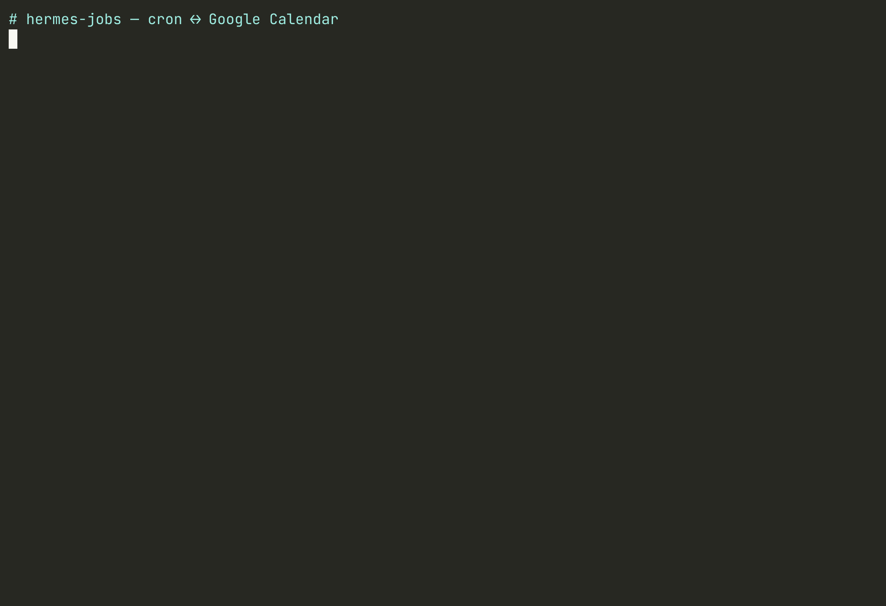

# hermes-jobs (automation)

**Your Hermes agent's scheduled work shows up on the calendar you already live in, and dragging it
there safely reschedules the real cron job.**

Hermes cron is the system of record. ONE Google Calendar is the job board. Every change, in either
direction, is planned as a dry run first and only applied when you run `--confirm`.



## Happy path

```bash
hermes hermes-jobs discover          # read-only: your cron jobs, oauth status, bound calendar
hermes hermes-jobs sync              # dry run: the exact ops in both directions, nothing written
hermes hermes-jobs sync --confirm    # apply that plan
```

In a Hermes chat, **`/jobs`** prints the next 7 days of Hermes jobs in agenda order, what is waiting on
you (pending ops from a dry-run plan, deferred "this and following" changes, unfinished moves), and the
exact confirm command. It never writes. Without Google sign-in it still shows the cron-only agenda.

Drag a recurring job's series in Calendar ("all events") and the next sync proposes the matching cron
change; edit the job in Hermes and the event follows (cron wins). All four of Google's recurring edits
("this event", "all events", "this and following", delete one instance) were tested live on Google
Calendar on 2026-11-09/10; what each one does is under [Recurring Google events](#recurring-google-events-event-mode-recurring-the-default).

**Run outcome.** Once a job has run, the dry run shows a `mark_run` op and the next confirmed sync colours its event from Hermes' own
`last_run_at` / `last_status` (Basil green = `ok`, Tomato red = `error`, Banana yellow = anything else,
e.g. `delivery_failed`) and keeps exactly one `last run: <local time> <status>` line in the description.
The line is replaced, never accumulated; the title is never touched; an unchanged outcome plans nothing;
a job that has never run gets no colour and no line. The error text itself never leaves the machine.

## Auto-sync (opt-in recipe, once you trust the plan)

The plugin never schedules itself and registers no hooks. If you want calendar edits picked up
without typing, create your own Hermes `no_agent` cron job with a fixed argv (no LLM, no shell
expansion of event text):

```bash
cat > ~/.hermes/scripts/hermes-jobs-sync.sh <<'SH'
#!/bin/sh
exec "$HOME/.local/bin/hermes" hermes-jobs sync --confirm   # use your `command -v hermes`
SH
hermes cron create --no-agent --script hermes-jobs-sync.sh --deliver local \
  --name "hermes-jobs auto-sync" "0 * * * *"
```

`--confirm` still refuses a moved occurrence of a recurring job unless you pass `--allow-additional-run` by hand, so the
recipe never accepts a duplicate run for you; `/jobs` lists it as waiting on you. The sync job is a cron
job like any other, so it appears on the board (one event that moves forward each hour). Stop it with
`hermes cron pause <id>` or `hermes cron remove <id>`.

## Setup

1. Create a Google Cloud **Desktop** OAuth client; enable Google Calendar API.
2. Set `HERMES_JOBS_GOOGLE_CLIENT_ID` and `HERMES_JOBS_GOOGLE_CLIENT_SECRET` in the Hermes profile env.
3. Sign in:

```bash
hermes auth add hermes-jobs:google
```

4. Enable / doctor:

```bash
hermes plugins enable hermes-jobs
hermes plugins doctor hermes-jobs --ci
hermes hermes-jobs discover   # read-only
hermes hermes-jobs status
hermes hermes-jobs sync       # dry-run by default
```

## Disclosure: network / credentials (catalog rule 13)

- Calls `https://www.googleapis.com` (Calendar API v3) only after Hermes oauth sign-in.
- Scope: `https://www.googleapis.com/auth/calendar.events` only (no Gmail/Drive/full calendar).
- Declare client under `oauth:` in `plugin.yaml`; sign in with `hermes auth add hermes-jobs:google`.
- Plugin uses `credentialed_provider_request("google", …)` — never reads `google_token.json`, `.env`, browser profiles, or google-workspace skill tokens.

- Full detail of what leaves the machine, local files and revocation: [SECURITY.md](SECURITY.md).

### What leaves the machine

- **Network**: Google Calendar API v3 on the ONE bound calendar only, via Hermes oauth. Every `sync`
  (dry-runs too) reads events; only `sync --confirm` writes. Sent: job name, schedule/RRULE, job id,
  prompt sha256 digest, private tags, and once a job has run its last-run time and status word (`ok`,
  `error`, ...) as an event colour + one description line. Never the prompt text, execution config or
  error text.
- **Reads outside plugin data**: `~/.hermes/cron/jobs.json` and Hermes config (time zone), read-only.
- **Cron changes**: only through Hermes' `cronjob_manage` tool, only on `--confirm`.
- **Experimental skip only** (off by default): writes `~/.hermes/scripts/hermes-jobs-skip-tick.py` and
  creates two one-shot `no_agent` cron jobs that run `hermes hermes-jobs skip-tick --quiet` (fixed argv,
  no shell). No other background processes; no telemetry; no stored credentials.

## Never

- Event text never grants tools, permissions, or prompts. A calendar title can only become a job *name*
  (sanitised: NFKC, no control/format/bidi/zero-width characters, single line, max 120 chars); a
  calendar time can only become a validated schedule. Descriptions are never parsed (the plugin only
  recognises its own `last run:` line, to replace it).
- No scopes beyond `calendar.events`.
- No writes without explicit `--confirm`. Discover never creates calendars or cron jobs.

## Sync (0.3.0)

```
hermes hermes-jobs bind primary          # choose the ONE calendar (local state only)
hermes hermes-jobs sync --offline        # dry-run against an empty calendar, no Google calls
hermes hermes-jobs sync                  # dry-run against the bound calendar
hermes hermes-jobs sync --confirm        # apply (human CLI step only; the agent tool can only plan)
hermes hermes-jobs sync --skip-original=experimental            # dry-run incl. the experimental skip steps
hermes hermes-jobs skip-tick             # advance pending experimental skips (run by their wake-up jobs)
hermes hermes-jobs mode [recurring|single]   # show/set event mode (recurring = default; single = fallback)
hermes hermes-jobs capture-fixtures <job_id> # read-only GETs -> sanitised tests/fixtures/*.json
```

- cron -> calendar: one 15-min event per job at its next run, tagged `extendedProperties.private.hermes_job_id`;
  title = job name (`[paused] ` prefix when paused); description = job id + prompt sha256 digest only,
  plus one `last run:` line once the job has run (see Run outcome).
- calendar -> cron (tagged events only, via Hermes' `cronjob_manage`): retitle -> name update;
  deleting an event **pauses**, never removes, its job. Untagged events are ignored and event text
  never grants tools or edits prompts.
- Conflicts: a cron edit wins and resets the event. A move never rewrites a recurring schedule.
- Tests: `hermes --run-module unittest discover -s tests` (planner, mocked runtime, security/injection
  tests, recurring-edit edge cases, and fixtures in `tests/fixtures`: `captured_*` are sanitised read-only GETs of the live probe,
  `documented_*` are built from Google's documented payload shapes and are marked as such). No Google
  calls or real cron writes.

### Recurring Google events (event mode `recurring`, the default)

A cron job whose expression converts **exactly** to an RRULE is shown as ONE real Google recurring
event (a master with `recurrence: [RRULE...]` and `start.timeZone` = the job's IANA zone). It is tagged
like every other event (`hermes_job_id`, full private prop set), its id is the derived occurrence key
of its first slot, and it is **not** patched forward (its DTSTART stays fixed; Google expands it).
Everything else keeps the single patch-forward event above: one-shots, interval jobs, and any cron
that does not convert.

| cron (job zone Australia/Sydney) | RRULE | back to cron |
| --- | --- | --- |
| `0 9 * * *` | `FREQ=DAILY` | `0 9 * * *` |
| `0 18 * * 1-5` | `FREQ=WEEKLY;BYDAY=MO,TU,WE,TH,FR` | `0 18 * * 1,2,3,4,5` |
| `30 7 * * MON,WED,FRI` | `FREQ=WEEKLY;BYDAY=MO,WE,FR` | `30 7 * * 1,3,5` |
| `0 9 1,15 * *` | `FREQ=MONTHLY;BYMONTHDAY=1,15` | `0 9 1,15 * *` |
| `0 9 25 12 *` | `FREQ=YEARLY;BYMONTH=12;BYMONTHDAY=25` | `0 9 25 12 *` |
| `0 9 * 6-8 *` | `FREQ=DAILY;BYMONTH=6,7,8` | `0 9 * 6,7,8 *` |
| `0 9 * * 0,7` | `FREQ=WEEKLY;BYDAY=SU` | `0 9 * * 0` |
| `0 2 * * *` | refused: 02:xx is skipped/repeated at a Sydney DST change | single event |
| `*/5 * * * *`, `0 9,17 * * *`, `0 */2 * * *` | refused: more than one time per day | single event |
| `0 9 1 * 1` | refused: cron ORs day-of-month with day-of-week; RRULE would AND them | single event |
| Calendar `INTERVAL=2`, `COUNT`, `BYDAY=1MO`, `BYMONTHDAY=-1`, `BYHOUR` | no cron equivalent | refused, nothing changes |

"Back to cron" is canonical numeric form (Sun = 0). A converted job's minute and hour must be single
values, and the wall time must exist exactly once on every day for the next ~800 days in its zone.
A `FREQ=WEEKLY` with no `BYDAY` takes its weekday from the event start.

**Migration.** A job that already has a single event gets `convert_to_recurring`: the SAME event is
patched (summary, description, tags, `start` = next run + `timeZone`, `recurrence`). No delete, no new
id, no orphan. Like every write it appears in the dry-run first and needs `--confirm`.

**Reading.** Events are listed with `singleEvents=false&showDeleted=true` (masters, singles, moved and
cancelled instances), and each current master's `/instances?showDeleted=true` is read for the next 60
days. Moved/cancelled instances are matched by `recurringEventId` + `originalStartTime`. Instances
before the job's next run are history and ignored. An event turned into an all-day event has no timed
start: a single event is patched back to its cron time, a master or split series is reported and refused,
and a moved all-day instance is ignored.

What each Google edit does on the next sync (dry-run shows it; `--confirm` applies it):

1. **"This event" (move one instance)** -> a one-shot copy at the new time, exactly as for single
   events: `--confirm` refuses without `--allow-additional-run` (the original slot ALSO runs), or use
   `--skip-original=experimental`. The series is unchanged. The moved instance itself *is* the copy's
   calendar entry (no extra event, not retagged). Moving it again moves the copy; deleting it pauses the
   copy (soft pause, as for any deleted event).
2. **"All events" (change the series' time or rule)** -> the cron schedule follows **only if** the new
   RRULE converts back cleanly (e.g. 09:00 -> 10:00 gives `0 10 * * *`; daily -> Mon/Wed gives
   `0 9 * * 1,3`). Otherwise (or if the series' time zone changed) the sync reports it, refuses, and
   changes nothing. Undo it in Calendar or edit the job in Hermes; cron wins on the next sync.
3. **"This and following"** -> Google ends the old master with `UNTIL` and creates a new series, usually
   with id `<old id>_R<date>`, sometimes without our tags. The plugin treats it as a series reschedule:
   it adopts the new series (`adopt_split`: tags it, makes it the job's event), the cron takes the new
   series' rule, and the old master stays untouched as history. It is never deleted, never becomes a
   second job, and is never orphaned (state keeps it under `history_ids`). Only a series tied to ours is
   accepted: tagged with this job id, or untagged with id prefix `<our master id>_R`. Untagged events are
   otherwise still ignored. If the old series still has runs left (its UNTIL is after the job's next run),
   the cron change is **deferred** (`split_pending`) until the first confirmed sync after the old series
   ends, so the remaining old-rule runs still fire. A split that starts at the original start (only the
   rule changed) is handled the same way, with an immediate cron change. If the new rule does not convert,
   nothing is adopted and nothing changes. An `UNTIL` with no follow-on series is reported (cron jobs
   cannot end on a date).
4. **Delete one instance** -> Hermes cannot skip a single run. Without the flag the sync reports `can't
   skip a single run ... nothing changed -- that run WILL still happen` under `info` (informational, not
   a pending op: `ops` stays empty). A confirmed sync records it in state and it is not shown again. With
   `--skip-original=experimental` it uses the experimental skip below (the next occurrence only; books
   one "missed" ledger row). No copy is created.

**Cron wins.** Editing the job in Hermes rewrites the master's start/RRULE (and drops pending move or
skip work, as before). Deleting the whole series is the usual soft-delete pause; after
`hermes cron resume <id>` the next confirmed sync recreates the master. A removed job's current master
is deleted; history masters never are. If a cron edit makes the job non-convertible, its master is
converted back to a single patch-forward event (`convert_to_single`).

**Fallback (single events).** `hermes hermes-jobs mode single` switches the board back to single events
for everything: the next confirmed sync converts each master into a single event in place (PATCH
`recurrence: []`, `start` = next run; same id), and from then on the original single-event path runs
unchanged (tests assert it plans identically to it). `mode recurring` switches back. Moved instances
that already became one-shot copies stay as they are.

### Deleted events: pause and recovery

Every deletion reports `job <id> paused because its calendar event was deleted; resume with hermes cron resume <id>`.
The CLI JSON `ops`/`messages` and `status` show this information. In a dry-run it is a proposed action,
not a claim that the job is already paused. Applied sync state keeps `paused_by_delete` and the reason,
including for a job that was already paused. **Its deleted event is not recreated while paused.**
Resume explicitly in Hermes, for example `hermes cron resume 28c2169b1b51`; the next confirmed sync
recreates its event and clears the tombstone. Calendar cannot resume it because its event is gone.

### Moving one occurrence (important limitation)

Moving the board's next occurrence of a recurring cron/interval job plans an absolute ISO one-shot
with `repeat=1`, named `<name> (moved <date>)`. It copies the source's prompt, delivery, skills,
script/monitor, tool allowlist (including `[]`), context, workdir and other supported execution fields.
Only trusted cron configuration is copied; the Calendar description is never used as instructions.
The moved event is retagged to the new job; `source_job_id` links it locally. On the **following sync**
the source gets a fresh event previewing its following recurring slot. Completion deletes the copy's
event (not its cron history); deleting that event before it fires pauses just the copy. Completed
copies do not respawn. Rearming/resuming remains an explicit Hermes action.

**Hermes currently has no public skip-occurrence action. The original occurrence WILL still run.**
Creating a copy is therefore an **additional run**, not an exact reschedule. Both the plan and CLI
return this warning. Ordinary `--confirm` **refuses** this case. After reviewing the dry-run, choose
one of two options:
`hermes hermes-jobs sync --confirm --allow-additional-run` explicitly accepts both executions (the
default and recommended choice), or `--skip-original=experimental` (below). Without the experimental
flag, the repeating schedule is never rewritten and the source is never paused. The source calendar
event's preview does **not** mean the still-pending original Hermes slot was suppressed. If duplicate
execution is unacceptable and you do not opt in to the experiment, cancel the move in Calendar instead.

**Series edit while a move is pending:** if the source's schedule, prompt or copied configuration
changes before the copy fires, the next confirmed sync drops the move. It removes the copy job and
its event, undoes any experimental skip, and re-plans the source from cron (cron wins). Renaming the
job is not a series edit.

### EXPERIMENTAL: `--skip-original=experimental` (true skip, off by default)

Hermes has no skip action, so this combines only public `cronjob_manage` actions. Slot `S` is the
original occurrence:

1. **At `--confirm`** (`S` must be at least 5 min away, the schedule must be a cron expression, and
   the job must be enabled with `next_run_at == S`), in this order:
   - Journal the job's original `grace_minutes`/`catch_up` in state.
   - Pause the job with reason `hermes-jobs skip {"k":<key>,"slot":...,"grace":...,"catch_up":...}`.
   - Set `grace_minutes=0` (Hermes floors this at 120 s). Set `catch_up=false` **only** if it was
     explicitly `true`; an absent value is left absent, because an explicit grace already disables
     catch-up, and `cronjob_manage` cannot clear it back to absent.
   - Create two one-shot **`no_agent` script jobs** (no LLM, `deliver: local`):
     `hermes-jobs skip-tick <key8> #1` at `S+10 min` and `#2` at `S+25 min`. Both run the installed
     `~/.hermes/scripts/hermes-jobs-skip-tick.py`, which runs `hermes hermes-jobs skip-tick --quiet`
     and prints nothing on success. These jobs never appear on the board.
   - Create the one-shot copy at the moved time, as in the default mode.

   We pause right away instead of just before `S`, because `S` is the board's *next* occurrence, so
   no other slot falls in that window. The job shows as paused in Hermes until `S+10 min`, but stays
   active on the board.
2. **`S+10 min` (wake-up #1, or any later sync/skip-tick):** resume. Hermes keeps an elapsed slot
   due on resume (#113603). It is past the 120 s grace and catch-up is off, so the next due scan
   **skips `S`, books one `missed ×1` row in the cron execution ledger** ("skipped, catch-up off"),
   and emits a `missed` metric. It sends no chat notification.
3. **`S+25 min` (wake-up #2, or any later sync/skip-tick):** once `next_run_at` is past `S`, restore
   the original `grace_minutes` (cleared if it was absent) and `catch_up`.

Before acting, every step checks that the job is unchanged (same fingerprint), is still paused **by
this marker**, and still has the same slot. Otherwise it aborts with a warning and restores the
grace/catch_up settings:
- A job that was paused manually is left paused.
- A job that was resumed manually is not touched; its original slot may run.
- An edited job is resumed (the pause was ours).
- An interrupted arming is undone.
- A slot that ran anyway is reported (`skip failed`).
The copy is independent of the skip and runs regardless. If sync state is lost while the job is
paused, the skip is rebuilt from the pause marker. If state is lost *after* the resume, nothing marks
the job anymore. The `grace_minutes=0` override (and `catch_up=false`, if it was set) then stays and
has to be restored by hand with `hermes cron edit`.

Limitations: it is experimental, cron expressions only, and depends on the gateway ticker scanning
within ~15 min of `S+10`. The skip shows up in Hermes run history as a **miss**, not as a deliberate
skip. A clean fix needs a Hermes `skip` action (see below).

Installed-source verification: `tools/cronjob_tools.py` defines actions create/list/update/pause/resume/
remove/run/cancel, but no skip. `_HANDLER_FORWARDED_ARGS` is the copy-field contract; the handler also
accepts monitor_script/monitor_url. `cron/jobs.py:parse_schedule` accepts offset-aware ISO timestamps
as `kind=once`. Its `advance_next_run(s)` is ticker bookkeeping calculated from **now**, not a future
slot-specific skip (calling it before a future slot leaves that slot unchanged), so it is not used.
`hermes cron resume --at` only re-arms one-shots; it cannot skip one recurring occurrence.

Pinned inference settings/interpreter overrides that dispatch cannot preserve cause the move to be
refused, not silently dropped. Source `origin` delivery is resolved from its recorded origin, not the
current CLI session; unresolved origin targets are refused. Pending ownership transfers are journaled
and retried without another create. After an uncertain create result, the retry first adopts an
existing copy with the same name and one-shot instant, and only creates one if none is found.
Sync is not a transaction across cron and Google; run a fresh dry-run after any partial error.

Offline mode projects against an empty calendar **and empty sync history**, so it never interprets
unfetched events as deletions. It does not bind a calendar, call Google, or change cron/state.

## Derived ids (reference stability)

Every scheduled occurrence has a stable **occurrence key**:
`uuid5(3ac1ead0-9909-5599-8d64-da65c43647dc, "<job_id>@<instant as ISO UTC>")`, written as 32 lowercase
hex. The namespace is a fixed literal and must never change. The instant is canonicalised to UTC, so
`09:00+11:00` and `22:00Z` give the same key. Hex is a subset of Google's event-id alphabet (base32hex
`a-v0-9`, 5-1024 chars), so the key doubles as a client-chosen Google event id.

- **Inserts** use the key of the occurrence the event shows as its Google event id. A retried insert
  gets `409`, and that means "already exists, adopt it": the plugin reads the event and patches it to
  the desired body. `status: confirmed` brings back a cancelled event that reused the id. An id owned
  by a *different* job's tag is refused, never taken over.
- **A recurring job's event shows its next occurrence and is patched forward, not recreated.** The id
  is fixed when the event is inserted. Each advance patches `start` and the private
  `hermes_occurrence` tag (the key of the occurrence it now shows) on the same event. That is one
  write per advance, never a delete plus insert, and Google keeps no trail of dead event ids. Insert
  retries stay idempotent through the derived id. Finding "what is tied to slot X" means matching
  `hermes_occurrence`, or the copy's `hermes_original_slot`, not the event id.
- **Every write sends the full private tag set** (`hermes_job_id`, `hermes_occurrence`, and for
  copies `hermes_source_job_id` + `hermes_original_slot`), so a PATCH can never strip the job tag.
- **One-shot copies and skips** are recorded in sync state under `occurrences[<key of the original
  slot>]`. Each record holds the source job, child job, event, mode, status, and the source's
  fingerprint: a digest of schedule + copied execution config, without name, enabled or grace.
- **Rebuilding after a lost state file:** calendar events are found by `hermes_job_id` and adopted,
  never deleted or recreated. Copy links come back from the event tags. A pause caused by deleting
  its event is recognised from Hermes' own `paused_reason` (`hermes-jobs: calendar event deleted`),
  so the deleted event is still not recreated. An armed experimental skip comes back from its pause
  marker (see below); its wake-up jobs are matched by name AND the installed script, never by name alone. A copy whose create succeeded but whose result was lost is adopted on retry,
  matched by name + one-shot instant; it is never created twice and never gets its own duplicate event.
- **Existing events keep their Google-assigned ids** (the two live probe events). They are adopted
  by tag, and they pick up `hermes_occurrence` on their next patch-forward. Nothing is deleted or
  recreated to migrate them.

## Repo

https://github.com/CrowBe/hermes-jobs

